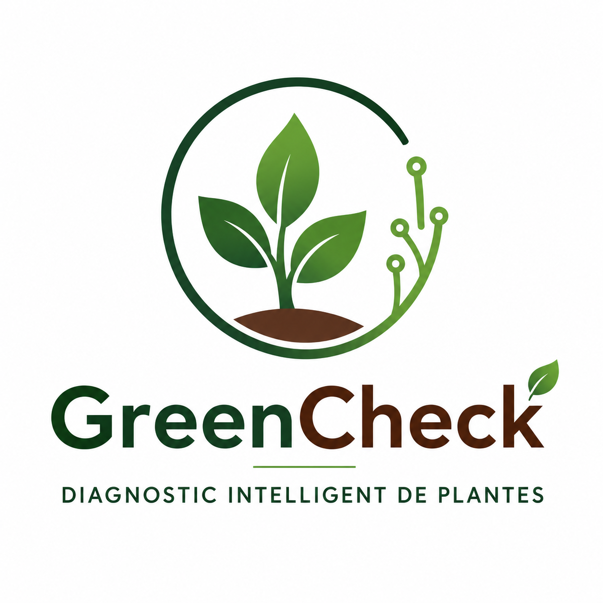

# CDC GreenCheck

Sujet de projet fil rouge pour la formation Concepteur, Développeur spécialité Intégration IA - Année 2026

## Initialisation de la BDD et création de l'utilisateur

Éxécuter le fichier ```initialise_db_and_user.sql``` dans MariaDB ou copier et coller le SQL puis l'éxécuter (**/!\ en root**)

## Préparer l'environnement

1. Copier backend/.env.example  → backend/.env  et remplir les valeurs
2. Copier frontend/.env.example → frontend/.env et remplir les valeurs
3. Lancer le conteneur MariaDB : docker compose up -d
4. Lancer le backend           : cd backend && uvicorn main:app --reload
   (au premier démarrage, les tables sont créées automatiquement)
5. Pré-remplir les diagnostics : voir la section ci-dessous (une seule fois)
6. Lancer le frontend          : cd frontend && npm run dev

## Pré-remplir les diagnostics (maladies et conseils)

Une fois le backend lancé **au moins une fois** (c'est lui qui crée les tables), exécuter le fichier ```seed_diagnostics.sql``` :

```shell
mariadb -u greencheck_user -p greencheck < seed_diagnostics.sql
```

(ou l'importer via l'onglet « Importer » de phpMyAdmin). Le script est idempotent : le relancer ne crée pas de doublons. Il affiche en dernière ligne un tableau de contrôle (état, maladie, nombre de conseils) : 12 diagnostics attendus.

## Lancer le projet

1. Faire 
   ```shell
   chmod +x start.sh   # rend le script exécutable (à faire une seule fois)
   ```
2. éxécuter le script : 
   ```bash
   ./start.sh
   ```